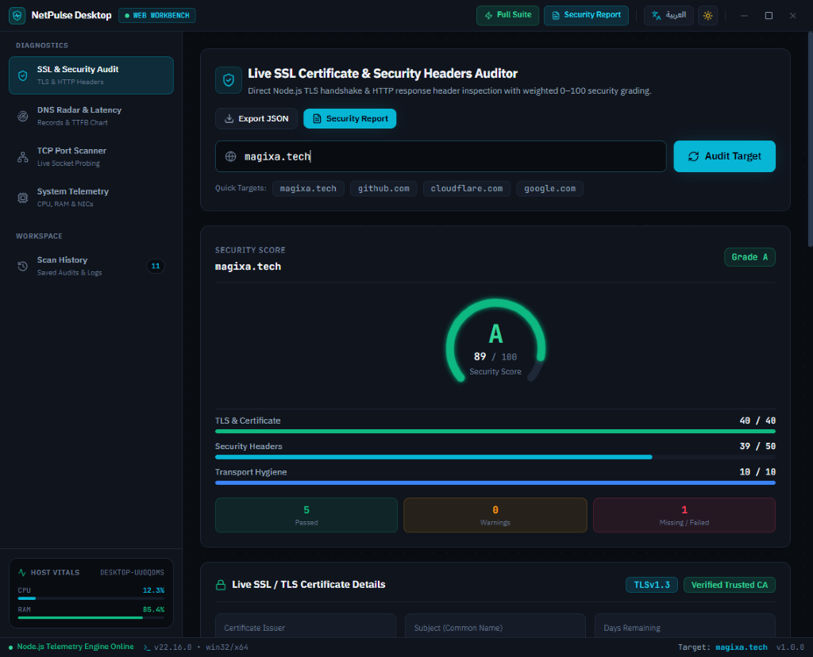
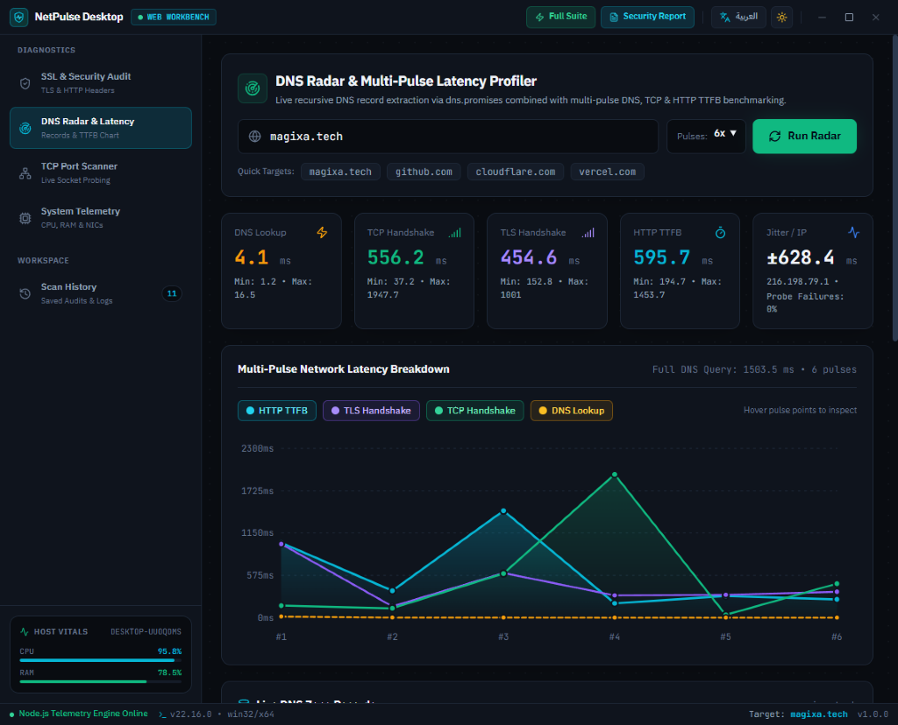
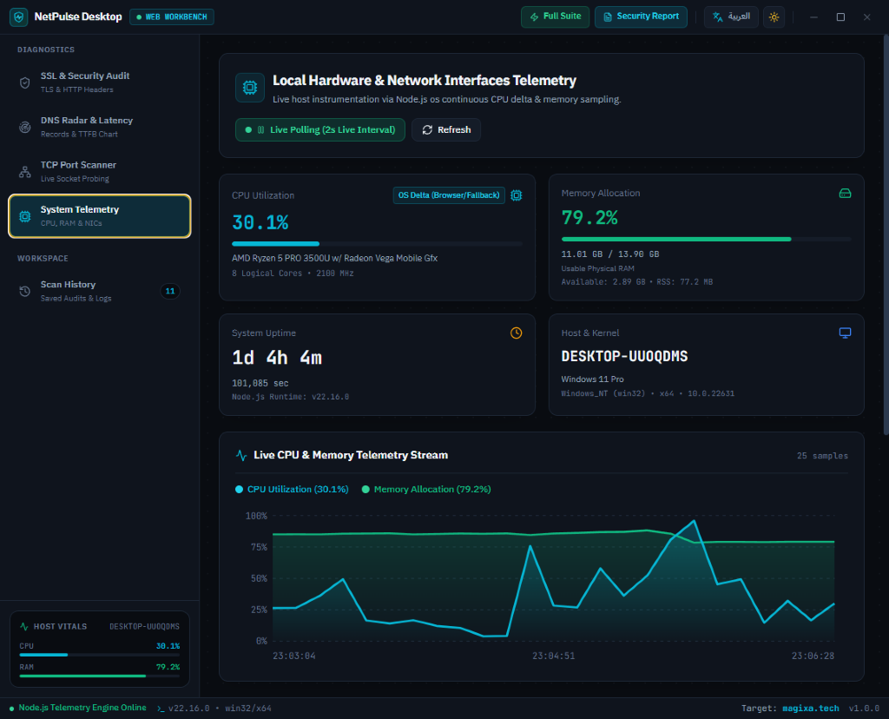
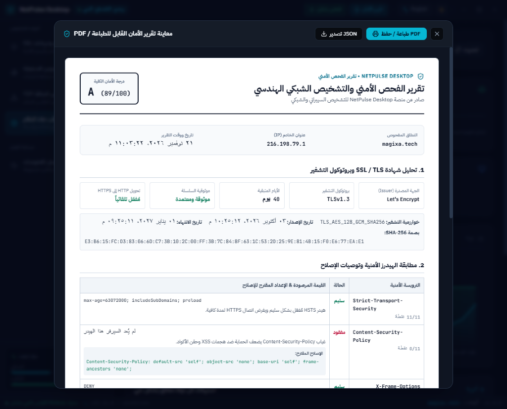

# NetPulse Desktop v1.0.0

**Network Telemetry, SSL/TLS Auditing, DNS Profiling & Cybersecurity Diagnostic Suite**

NetPulse Desktop is a hybrid **Next.js 15 (App Router)** + **Electron 35** diagnostic workbench engineered around real Node.js network sockets (`tls`, `https`, `http`, `dns`, `net`) and native OS hardware telemetry — with **zero mock data**. It ships both as a standalone **Windows Desktop application** and as a hardened **Vercel / Web deployment** from a single codebase.

> **Bilingual UI (English + Arabic):** Instant language switching between English and Arabic, keeping the desktop chrome (`DesktopTitleBar`, sidebar navigation, window controls, charts, and technical telemetry) structurally locked in LTR while rendering Arabic prose, Bidi mixed labels, and exported Arabic A4 PDF reports in proper native RTL.

---

## Architecture Overview (Dual-Mode)

| Capability | Windows Desktop Mode (Electron Standalone) | Cloud / Web Mode (Vercel Serverless) |
| :--- | :--- | :--- |
| **Runtime** | Electron 35 + embedded Next.js standalone server on `127.0.0.1` (`ELECTRON_RUN_AS_NODE=1`, `NETPULSE_DESKTOP_MODE=1`) | Standard Next.js Node.js serverless routes (`VERCEL=1` / `NETPULSE_CLOUD_MODE=1`) |
| **System Telemetry** | Electron IPC via `electron/telemetry.js` + Windows PDH `typeperf.exe` | Explicitly disabled (`HTTP 403`) to protect cloud host privacy |
| **Private / LAN Targets** | Allowed when running locally in non-cloud Desktop mode | Strictly blocked via SSRF & DNS-rebinding guards |
| **PDF Security Reports** | Native Chromium `webContents.printToPDF()` + save dialog & `window.print()` fallback | Browser `window.print()` A4 print stylesheet |

---

## Core Diagnostic Modules

1. **Live SSL/TLS & Security Headers Auditor (`/api/audit`)**
   - Performs direct Node.js `tls.connect` handshakes and pinned HTTPS requests to inspect the full OpenSSL certificate chain (`subjectCN`, `issuerCN`, intermediate/root expiry walk), SHA-256 fingerprint, Subject Alternative Names (SANs), negotiated protocol (`TLSv1.3` / `TLSv1.2`), cipher suite, and key strength.
   - Evaluates weighted security headers (`Strict-Transport-Security`, directive-aware `Content-Security-Policy` separating `script-src` vs `style-src`, `X-Frame-Options` + CSP `frame-ancestors`, `X-Content-Type-Options`, `Referrer-Policy`, `Permissions-Policy`), audits `Set-Cookie` flags (`Secure`, `HttpOnly`, `SameSite`), falls back to plaintext HTTP when port 443 is unavailable, and caps untrusted, expired, or MITM chains honestly at **Grade F**.

2. **DNS Radar & Multi-Stage Latency Telemetry (`/api/dns-ping`)**
   - Extracts live `A`, `AAAA`, `MX`, `TXT`, `NS`, `CNAME`, and `SOA` zone records alongside consecutive single-socket `DNS / TCP / TLS / HTTP TTFB` lifecycle pulses, min/avg/max/jitter statistics, and interactive SVG charting (`LatencyChart`).
   - Automatically falls back to public resolvers (`1.1.1.1` / `8.8.8.8`) if local OS DNS fails on large `TXT` payloads (`EREFUSED` / `ETIMEOUT` / `SERVFAIL`), surfaces an **OS Cache** badge when DNS lookups resolve from local cache (`< 2 ms`), and selects responsive Anycast endpoints across multi-IP domains.

3. **Paced TCP Port Scanner (`/api/port-scan`)**
   - Probes standard (`21, 22, 80, 443, 3000, 3306, 5432, 6379, 8080`), Web/Proxy, Database, or custom TCP port lists (up to 24 ports) using `net.Socket`.
   - Prioritizes `443` and `80` first with paced socket launches (`60 ms` stagger, concurrency `3`) to prevent ISP SYN drops, performs automatic **multi-IP Anycast failover** (`resolveAllValidatedHosts`) when an upstream edge IP blackholes connections, retries critical web ports once on domains, supports **Fast (`1.8s`) / Deep (`3.5s`)** timeout modes, and classifies `open`, `closed` (`ECONNREFUSED`), `filtered` (`TIMEOUT`), and OS `error` states.

4. **Native System Telemetry (`electron/telemetry.js` & `/api/system`)**
   - On Windows, spawns a single persistent `C:\Windows\System32\typeperf.exe` collector (`\Processor Information(_Total)\% Processor Utility -si 2`) matching Windows Task Manager CPU utility with zero per-poll CPU spikes, paired with continuous per-core delta sampling, usable physical RAM, combined Electron + embedded server Working Set memory (`app.getAppMetrics()` + `Get-Process`), and live network adapters (`IPv4`, `IPv6`, `MAC`, `CIDR`).
   - Guarantees zero-orphan teardown (`before-quit` kills both the `typeperf.exe` child and the entire embedded Next.js process tree via Windows `taskkill.exe /T /F`).

5. **Offline Arabic (RTL) & English Printable PDF Reports + JSON Export + History**
   - Exports formatted A4 engineering security reports (`PrintableReport.tsx`) in either **Arabic (`dir="rtl"`)** or **English (`dir="ltr"`)** with self-hosted offline fonts, one-click structured JSON telemetry bundles, and persistent `localStorage` scan history (`HistoryPanel.tsx`).

---

## Security & Engineering Design

- **Electron Process Hardening (`electron/main.js`, `electron/preload.js`)**:
  - Enforces `contextIsolation: true`, `nodeIntegration: false`, and `sandbox: true` on `BrowserWindow`.
  - Locks `will-navigate` to the trusted local server origin, denies popup windows cleanly (`shell.openExternal` for external `http(s)` links only), and verifies every `ipcMain.handle` call against `assertTrustedSender(event)` (`webContents` + `senderFrame.url` origin check).
- **SSRF, Redirect & DNS-Rebinding Defense (`src/lib/network-guard.ts`)**:
  - Blocks literal, resolved, and redirect-hop private/reserved/metadata IPs (`127.0.0.0/8`, RFC 1918, `169.254.0.0/16`, `100.64.0.0/10`, `::1`, `fc00::/7`, `fe80::/10`, IPv4-mapped `::ffff:...`, NAT64) whenever cloud mode is active.
  - Wraps DNS resolution with explicit timeouts and pins outbound `tls.connect` / `http(s).request` calls to the exact validated IP via `createPinnedLookup`.
- **Honest Engineering Scope Note (Single-Handshake TLS vs Exhaustive Multi-Minute Scanners)**:
  - NetPulse performs a fast single-handshake OpenSSL inspection (`~100–300 ms`) to give immediate visibility into chain validity, expiry, TLS version, active cipher suite, HTTP headers, and cookie flags. Exhaustive multi-minute scanners (such as Qualys SSL Labs) actively probe dozens of deprecated protocol downgrades (TLS 1.0/1.1, SSLv3), weak ciphers, and side-channel attacks (BEAST, ROBOT, POODLE) — treat NetPulse as rapid developer/ops feedback alongside periodic full external cipher-matrix audits.

---

## Screenshots

### 1. Live SSL/TLS Certificate & Security Headers Auditor


### 2. DNS Radar & Multi-Pulse Latency Telemetry


### 3. Real-Time System Telemetry & CPU/Memory Stream


### 4. Printable Arabic (RTL) A4 PDF Security Report


---

## Quick Start & Build Commands

### Prerequisites
- **Node.js** 20+ (tested on Node v20 / v22)
- **Windows 10/11 (x64)** for Electron desktop packaging & Windows PDH telemetry

```bash
# 1. Install dependencies
npm install

# 2. Run web development server (http://127.0.0.1:3000)
npm run dev

# 3. Run type checking & linting
npm run typecheck
npm run lint

# 4. Run standard Next.js production build (Vercel / Web deployment)
npm run build

# 5. Launch Electron connected to Next.js dev server
npm run electron:dev

# 6. Build unpacked Windows Electron app (dist-electron/win-unpacked)
npm run electron:pack

# 7. Build final Windows NSIS Installer & Portable .exe (dist-electron/)
npm run electron:dist
```

---

## Download (Windows Desktop v1.0.0)

Publish the generated `dist-electron/` release binaries as assets under your GitHub repository **Releases** (`v1.0.0`):

- **Windows Installer (NSIS x64):** `https://github.com/<your-username>/netpulse-desktop/releases/download/v1.0.0/NetPulse.Desktop.Setup.1.0.0.exe`
- **Windows Portable (x64):** `https://github.com/<your-username>/netpulse-desktop/releases/download/v1.0.0/NetPulse.Desktop.1.0.0.exe`

> **Packaging & SmartScreen Note:** `package.json` sets `"signAndEditExecutable": false` so Windows builds succeed offline without requiring Windows Developer Mode for `winCodeSign` symlink extraction. Because release binaries are unsigned portfolio builds unless you supply a code-signing certificate, Windows SmartScreen may prompt *More info -> Run anyway* on first launch.
